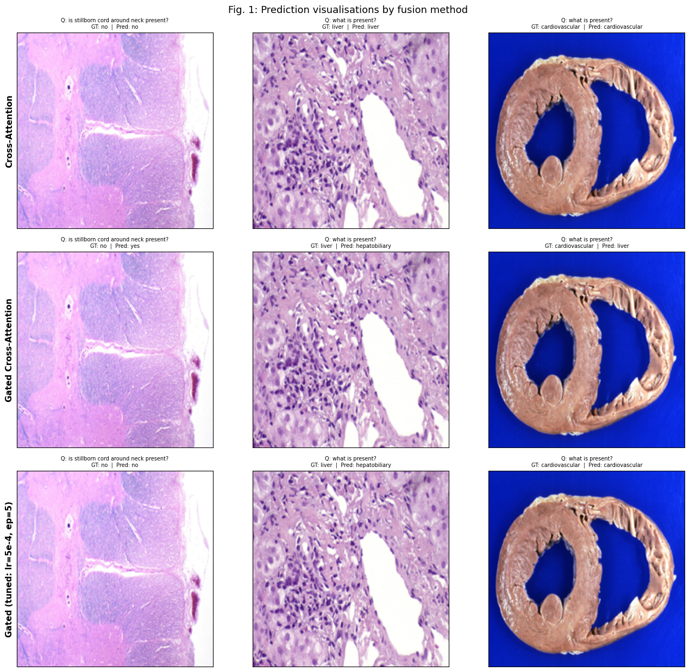
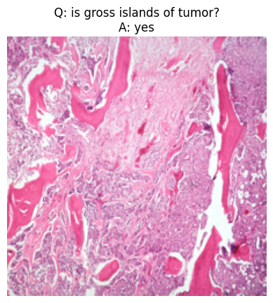

# Pathology Visual Question Answering: Gated Multimodal Fusion with LoRA

A vision-language model that answers natural-language questions about pathology images, built by joining a frozen vision transformer to GPT-2 through cross-attention, and adapting it with LoRA so only 3.6% of parameters are trained.

**Stack:** Python, PyTorch, Hugging Face Transformers, PEFT (LoRA), datasets, evaluate



---

## The problem
Pathology images carry the answer, but the language model has never seen an image. The task is to let GPT-2 attend to visual features without retraining two large models end to end.

## Data
[PathVQA](https://huggingface.co/datasets/flaviagiammarino/path-vqa): pathology images with open and yes/no question-answer pairs. A 3,000-image subset was used to fit the compute budget.



## Architecture
```
Pathology image ──► ViT-base (frozen) ──► image tokens
                                              │
Question ──► GPT-2 + LoRA adapters ◄── cross-attention fusion ──► Answer
```
- **Cross-attention fusion:** GPT-2 hidden states attend to ViT patch embeddings.
- **Gated cross-attention (Flamingo-style):** each fusion block's output is scaled by a learned `tanh` gate initialised at zero, so training starts from plain GPT-2 and the model learns how much visual information to let in.
- **LoRA:** low-rank adapters in GPT-2's attention layers. Trainable parameters: **7.9M of 218.7M (3.61%)**.

## Results
| Model | BLEU-1 | BLEU-2 | ROUGE-L | METEOR |
|---|---|---|---|---|
| Cross-attention (non-gated) | 0.405 | 0.000 | 0.411 | 0.205 |
| Gated, default settings | 0.300 | 0.000 | 0.347 | 0.174 |
| Gated, retuned learning rate and epochs | 0.358 | 0.015 | **0.448** | **0.226** |

- The gated model started slowly. That was predictable from first principles: `tanh(0) = 0`, so at initialisation the image contributes nothing and the gate has to learn to open. Retuning the learning rate and training longer fixed it.
- After retuning, the gated model beat the non-gated baseline on ROUGE-L, METEOR and BLEU-2.
- BLEU-2 is near zero for every model because many answers are a single word (yes/no), so there are no bigrams to match. This is a metric artefact, not a model failure.

## Repository structure
```
notebooks/pathvqa_gated_fusion_lora.ipynb   data loading, model, training, inference, experiments
figures/                                     figures exported from the notebook
requirements.txt
```

## How to run
```bash
pip install -r requirements.txt
jupyter notebook notebooks/pathvqa_gated_fusion_lora.ipynb
```
A GPU is needed for training. The dataset downloads from Hugging Face.

## References
- He X. et al. *PathVQA: 30000+ Questions for Medical Visual Question Answering.* 2020
- Dosovitskiy A. et al. *An Image is Worth 16x16 Words.* ICLR 2021
- Hu E. et al. *LoRA: Low-Rank Adaptation of Large Language Models.* ICLR 2022
- Alayrac J.-B. et al. *Flamingo: a Visual Language Model for Few-Shot Learning.* NeurIPS 2022

## Author
**Judah Akinlaja**, Health Data Scientist
[LinkedIn](https://www.linkedin.com/in/judah-akinlaja-a10385194) · [Portfolio](https://judahakinlajar.co.uk) · [GitHub](https://github.com/Akinlajar)
